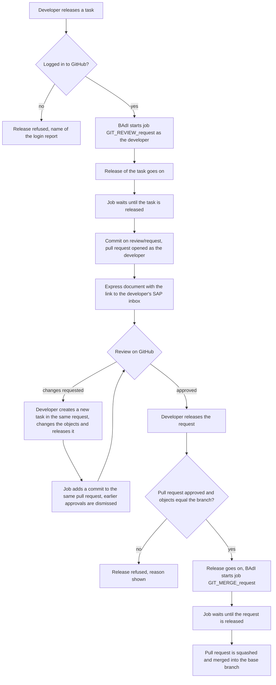

# abap-transport-review

**Reviewed, traceable and controlled transports for SAP ABAP development.**

This project connects the SAP transport system with GitHub pull requests. Releasing a task commits its objects to a review branch and opens a pull request. A request cannot be released until a colleague has approved that pull request, and the release of the request merges it. Exceptions are explicit and visible: the marker `#NOREVIEW` in the request text, the switch `ZTR_DISABLED`, and a failure of the check itself, which never stops a release. See [docs/WORKFLOW.md](docs/WORKFLOW.md).

Everything runs inside the SAP development system, in ABAP, on top of [abapGit](https://github.com/abapGit/abapGit). The tools are local objects of the development system and are not transported.

## Why use it

The purpose is clean code and controlled releases. A change leaves the development system only after another person has reviewed it, and everything about the change is recorded: when it was released, what changed, who made it, who approved it, and why.

In many landscapes these questions are hard to answer after the fact. With this project the answers are in Git and on GitHub:

| Question | Where the answer is |
|---|---|
| What changed? | The diff of the pull request: every object, line by line, with one commit for each released task |
| Who made the change? | The commits, made under the name and e-mail of the owner of the task as the user master of SAP holds them, and the pull request, opened under the GitHub account of the developer who released the task |
| Who reviewed and approved it? | The reviews on the pull request: comments, requested changes and the approval, each with the person and the time |
| When was it released? | The description of the pull request, which carries the release stamp that SAP writes into the documentation of a task when it is released, and the merge commit on the base branch, which carries the time of the merge |
| Why was it made? | The issue key at the start of the request text, which is in the commit message, in the pull request title and in the issue tracker |
| Which transport carried it? | The request number at the start of every commit message and of the pull request title, and the branch `review/<request>` |
| Were the remarks of the reviewer dealt with? | The conversations on the pull request, which have to be resolved before it can be merged |

The second approval and the rule on conversations come from the branch rules of the repository ([docs/GITHUB-REPOSITORY-SETUP.md](docs/GITHUB-REPOSITORY-SETUP.md)).

What you gain:

- **Quality through a second approval.** Every task becomes a pull request under the developer's own GitHub account, and the request cannot be released until its pull request is approved by somebody else: GitHub does not count the approval of the author. You decide when and how a transport can leave the development system, and a change that nobody else has looked at does not get out.
- **Clean code that is checked where everybody can see it.** abaplint can run on GitHub on every pull request (the syntax of your target release and the Clean ABAP rules; the workflows are in `github-templates/`), and you can turn on GitHub Copilot code review for the repository (it needs a Copilot licence). Copilot reviews the diff automatically, guided by the instructions in `.github/copilot-instructions.md`. A colleague therefore starts from a diff that has already been checked, and nobody has to spend an AI session on their own machine for it. The review by Copilot is a comment, not the required approval; the approval comes from a person. How to turn it on: [docs/GITHUB-REPOSITORY-SETUP.md](docs/GITHUB-REPOSITORY-SETUP.md#ai-assisted-review-with-github-copilot-optional).
- **Review on a diff.** The review uses a diff with inline comments, the history and the blame of Git, not a list of the objects of a transport.
- **Linked to the issue tracker.** Start the request text with the issue key and Jira, Linear, Azure Boards or GitHub Issues show the pull request and its merge on the issue ([below](#linking-issues-pull-requests-and-merges)).
- **Works on older systems.** SAP NetWeaver 7.40 SP08 and newer, on-premise or private cloud. The classic transport request still moves the change between systems; nothing in your landscape changes.
- **Developers keep their way of working.** They release in SAP GUI or in Eclipse ADT as before and log in to GitHub once. The push, the pull request and the merge run as background jobs.
- **Exceptions are controlled and auditable.** The tools can be switched off for a system (`ZTR_DISABLED`). One request can be released without review with `#NOREVIEW`; the marker stays in the description of the request, where it can be listed. A failure of the check itself never stops a release.

It is not meant for the cloud editions of S/4HANA or the BTP ABAP environment, and it does not replace the delivery of transports to other systems; see [gCTS and this project](#gcts-and-this-project) and the [roadmap](#roadmap).

## How it works

1. **Work as usual.** A developer changes objects in a request with tasks, in SAP GUI or in Eclipse ADT. The short text of the request starts with the issue key ([below](#linking-issues-pull-requests-and-merges)).
2. **Release a task.** The release check makes sure the developer is logged in to GitHub (a popup in SAP GUI the first time). A background job then commits the objects of that task to the branch `review/<request>`, opens a pull request from it, if there is none yet, and sends the link to the developer's SAP inbox. What abapGit cannot write, such as table rows, report variants and authorization profiles, goes along as JSON files under `content/` in the same commit, so it is reviewed too ([below](#objects-that-abapgit-cannot-write-the-content-folder)).
3. **Review on GitHub.** The checks of the repository run on the pull request (abaplint, and Copilot if you turned it on). A colleague reads the diff, comments and approves. The reviewer approves; the reviewer does **not** merge. The author cannot approve their own pull request. By default a colleague who pushed a later commit can still approve; the ruleset option "require approval of the most recent reviewable push" closes that.
4. **Rework, if the review asks for changes.** The developer does not touch the pull request. They create a **new task in the same request**, make the changes and release that task. The job adds a **new commit to the same branch**, so the same pull request shows the new change. A new commit dismisses the approvals given before (with the ruleset of this project), so the reviewer looks again. This repeats until the pull request is approved and all conversations are resolved.
5. **Release the request.** The release check compares the objects of the request with the approved pull request. If it is approved and nothing changed since, the release goes on. If it is not approved, or an object changed after the last push, the release is refused with the reason, and a changed object is pushed to the same pull request so that it can be reviewed again.
6. **The merge happens from SAP, never on GitHub.** When the request is released in SAP, a job squashes and merges the pull request into the base branch, through the GitHub App. Nobody merges on GitHub, and a rule on the repository enforces it: only the release in SAP, or an administrator, can update the base branch ([`github-templates/github-restrict-merge.sh`](github-templates/github-restrict-merge.sh)). The reason is that the base branch must contain only what has been released. Without the rule, somebody could merge an approved pull request while the request is still open, and then a new task in that request, with a change that was never reviewed, would be released after the merge; Git would no longer show what was reviewed and what the transport delivers. The commit title is the request text followed by the number of the pull request, so the issue tracker shows the merge. The rule is a ruleset of GitHub, not part of the ABAP code: set it up as described in [docs/GITHUB-REPOSITORY-SETUP.md](docs/GITHUB-REPOSITORY-SETUP.md), and test it on your repository first, because whether GitHub accepts the merge of the App for a developer without administrator rights is not proven by this project.
7. **Transport as before.** The transport request moves to the other systems in the way your landscape does it today. Git holds the reviewed copy; it does not deploy. If a change reaches another system through Git instead, abapGit brings the objects and the report `ZTR_APPLY_CONTENT` brings the `content/` files.

Who sees what: the **developer** works in SAP and reads refusals as a popup (SAP GUI) or an error message (ADT); the **reviewer** works only on GitHub; the **administrator** sets the branch rules once and can merge by hand in an emergency. Details: [docs/WORKFLOW.md](docs/WORKFLOW.md).

## Quick start

Full checklist with what to do when a step fails: [docs/INSTALL.md](docs/INSTALL.md).

| # | Do | Where | Green result |
|---|---|---|---|
| 1 | Install the abapGit **developer version** | `ZABAPGIT` runs and shows its start screen | You can open `ZABAPGIT` and create an online repository |
| 2 | Create a GitHub App (device flow on, expiring user tokens off) and install it on your repositories. Note its **Client ID** | GitHub, Settings, Developer settings, GitHub Apps. See [docs/GITHUB-LOGIN.md](docs/GITHUB-LOGIN.md) | The App page shows a Client ID and "Enable Device Flow" is ticked |
| 3 | Pull this repository into the local package `$ZTR_REVIEW` | `ZABAPGIT`, New Online, branch `master`, then Pull and activate | Report `ZTR_SETUP` exists and the BAdI implementation `ZTR_RELEASE_CHECK` is active (SE19) |
| 4 | Enter the Client ID and the package pattern, tick "Write the settings", execute | Report `ZTR_SETUP` (SA38) | The output has no red line. Yellow lines are information |
| 5 | Every developer logs in to GitHub once. In SAP GUI this also happens automatically at the first release (a popup). In Eclipse ADT there is no popup: the release is refused until the developer has logged in | Report `ZTR_GITHUB_LOGIN` (SA38), Log in; in ADT the class `ZCL_TR_CONSOLE_LOGIN`, run twice with F9 | "Logged in to GitHub as `<login>`" |

<!-- screenshot, see docs/images/README.md

*What to look at: one line per check, no red line.*
-->

## The flow



Details of every step, the results of the release check and the limits: [docs/WORKFLOW.md](docs/WORKFLOW.md).

Everything on GitHub happens under the account of the developer who releases. There is no shared technical user and no token in SM59. Each developer logs in once (GitHub device flow); the token is kept per SAP user, encrypted.

## Linking issues, pull requests and merges

The tools do not talk to your issue tracker. They write the **short text of the transport request** into the commit message, the pull request title, the pull request description and, at the merge, the squash commit. Start the request text with the issue key, and the integration between GitHub and your tracker does the rest:

```
ABC-123 Fix posting date check
```

| Tracker | What to start the request text with | What you see |
|---|---|---|
| Jira (GitHub for Jira app) | the issue key, for example `ABC-123` | the pull request, its commits and the merge in the Development panel of the issue |
| Linear | the issue identifier, for example `ENG-123` | the pull request linked to the issue, and its state follows the pull request |
| Azure Boards | `AB#123` | the work item linked to the pull request and the commit |
| GitHub Issues | `#123`, or `Fixes #123` to close the issue at the merge | the pull request linked to the issue |

Other trackers that read issue keys from pull request titles and descriptions work the same way; read their documentation for the exact format. These are the standard behaviours of the integrations, which read the title, the commit message and the description. Only Jira has been used with these tools.

Two things to know:

- The **branch name** is `review/<request>`, with the request number and not the issue key. A tracker that links only by branch name will not find the issue; the title and the commit message have the key.
- **Nothing checks the key.** A request without a key is reviewed like every other. [docs/JIRA.md](docs/JIRA.md) shows exactly what is written where, and how a check for the key could be added.

## Releasing without review: `#NOREVIEW`

Write `#NOREVIEW` anywhere in the short text of a **request**, upper or lower case, for example `#NOREVIEW ABC-123 Fix posting run`. The release of that request then skips the check: no login check, no review check and no merge job. Use it for an emergency, not to save time.

- **What still happens.** The tasks of the request were pushed when they were released and have their pull requests as usual. Those pull requests stay open. An admin merges or closes them on GitHub; nothing merges them automatically, and the rules of the base branch on GitHub still apply.
- **It is visible.** The marker stays in the description of the request. To list the requests that used it, read table `E07T` for descriptions containing `#NOREVIEW` (SE16).
- **It only affects the release of the request.** Tasks are not affected.
- **Nobody checks who writes it.** Anyone who may change the request text can use it. If that is a problem for you, review the list of requests with the marker regularly, and write the reason into the documentation of the request.

## Objects that abapGit cannot write: the `content/` folder

abapGit turns repository objects (classes, interfaces, tables, programs and so on) into files under `src/`. A transport carries more than that: table rows, report variants, authorization profiles, old OTR texts, ALV layouts and SAP Note entries. This project writes them as JSON files under `content/`, in the same commit and the same pull request as the objects, so a reviewer sees them too.

| Entry of the transport | File |
|---|---|
| Table rows (delivered content and customizing) | `content/tables/<table>.json`, one object for each row, sorted by key, without the client |
| Report variants | `content/variants/<report>.<variant>.json`: header, texts and values |
| SAP Note entries | `content/notes/<entry>.json`: the note number and the version, not SAP's code |
| Anything else | not written; the pull request lists it under "Not in Git" |

**Bringing it into another system.** abapGit pulls only `src/`. The report `ZTR_APPLY_CONTENT` does the rest:

1. Create the request for the change and pull the objects with abapGit into it.
2. Run the report as a test run. For each file it lists the rows and variants that are new, different, equal and only on this system. Nothing is changed.
3. Run it with "Write" and that request. The keys are recorded in the request first, then the rows are written. The request travels on like any other.

The report writes only what the tools themselves write to Git: tables of packages under Git that SAP delivers as content (delivery class E, S or G) or that you list, and variants of reports of those packages. Each write needs the authorization `S_TABU_NAM` for the table. Credential fields are never taken from Git. SAP Note entries are only reported; you implement the note in SNOTE.

Set `ZTR_REQUIRE_COMPLETE` to refuse a request that holds something that cannot be written to Git. All details, the file formats and the limits: [docs/NOT-IN-GIT.md](docs/NOT-IN-GIT.md).

## Eclipse ADT and Claude Code

The release itself works in SAP GUI and in Eclipse ADT. Only two things need a person to run something: the check of a system and the one-time login of each developer. In ADT, without SAP GUI, there are two optional console classes in the sub-package `$ZTR_REVIEW_CONSOLE`. Open the class and run it with F9 (Run As, ABAP Application (Console)).

| Class | What it does |
|---|---|
| `ZCL_TR_CONSOLE_CHECK` | The check of `ZTR_SETUP` without writing anything. One line per point, starting with `[ OK ]`, `[ TODO ]` or `[ INFO ]` |
| `ZCL_TR_CONSOLE_LOGIN` | The GitHub login in two runs. The ADT console shows its output only when a run has ended, so the first run prints the address and the code, you enter the code on GitHub, and the second run finishes the login. Run it a third time to see the status |

Writing the settings needs input and stays in report `ZTR_SETUP`. The same classes can be started from a script or from Claude Code through the ADT HTTP interface, because they only write text.

The console interface `IF_OO_ADT_CLASSRUN` exists on 7.40 SP25 and on S/4HANA 2023. On another release check it in SE24; if it is missing, leave the sub-package out of the pull (step 4 of [docs/INSTALL.md](docs/INSTALL.md)). Everything else works without it.

Why no Fiori app: the tool is used by developers on development systems, and a Fiori app would need Gateway, a Launchpad and a deployed UI5 application on a system that may be 7.40. The logic is in classes (`ZCL_TR_SETUP`, `ZCL_TR_AUTH`) without a screen, so a UI can be put on top later.

## Prerequisites

| Needed | Why |
|---|---|
| SAP_BASIS 7.40 SP08 or newer | the sources are written in ABAP 7.40 syntax (SP08) |
| abapGit **developer version** on the system (`ZABAPGIT`, package `$ABAPGIT`) | the tools call its classes; the standalone report is not enough |
| Outbound HTTPS from the SAP system to `github.com` and `api.github.com` (port 443) | every call to GitHub |
| SSL client `ANONYM` in STRUST that trusts GitHub's certificate chain (import the root certificates) | the same; abapGit needs it as well. `ZTR_SETUP` tests both hosts |
| A GitHub user or organization with the repositories of your packages | the pull requests live there |
| A GitHub App installed on those repositories | the token of each developer is issued by it and only sees repositories the app is installed on |
| Write access of every developer to the repositories | the app cannot give anybody more than they have |

## gCTS and this project

gCTS (Git-enabled Change and Transport System) is SAP's own integration of Git with the transport system: a released transport request is committed to a Git repository, and other systems get the change by pulling it ([SAP: gCTS and the transport system](https://support.sap.com/en/tools/software-logistics-tools/change-and-transport-system.html), [SAP: merging into the main branch](https://help.sap.com/docs/SAP_S4HANA_CLOUD/6aa39f1ac05441e5a23f484f31e477e7/e5aab94647dc456aa6c1981521c7046c.html)).

**What gCTS does not give you**, as far as SAP's documentation shows:

- **A gate at the release.** gCTS commits when the request is released. A review can sit on the merge into the branch that other systems pull, but nothing holds back the release itself until a pull request is approved. This project refuses the release of the request until the pull request is approved, and opens a pull request for every task.
- **Systems before S/4HANA 1909/2020.** gCTS is not available on SAP NetWeaver 7.40 and similar releases. This project is written for 7.40 SP08 and newer.
- **The abapGit file layout.** gCTS keeps the content of a transport in its own layout. abaplint on GitHub, and a pull of the code into another ABAP system with abapGit, read the abapGit layout, which this project writes.

**What this project does not give you that gCTS does:** delivery of released transports to other systems by pulling from Git, support from SAP, and use in the cloud editions.

gCTS and this project must not write to the same repository. Running both on the same package, each with its own repository, may be possible; this has not been tried. Check the current SAP documentation for your release before you decide.

## Supported systems

The tools are classic ABAP on an on-premise or private-cloud system. They use the classic transport check (BAdI `CTS_REQUEST_CHECK`), background jobs, report variants and the cluster table `INDX`, none of which is part of ABAP Cloud.

| System | State |
|---|---|
| SAP NetWeaver 7.40 SP25 | All classes and reports compile without errors |
| S/4HANA 2023 (SAP_BASIS 7.58) | All classes and reports compile without errors; 35 unit tests and the two ADT console classes run |
| 7.40 SP08 to SP24 | Written for the syntax of SP08 (checked with abaplint); not run on these releases |
| 7.50 to 7.57, S/4HANA 1809 to 2022, 2024 and 2025, S/4HANA Cloud Private Edition | Expected to work, because the same classic ABAP and BAdI are used; not tested |
| S/4HANA Cloud Public Edition, SAP BTP ABAP environment | **Not supported.** See the roadmap |

abapGit has to be the developer version of a release that matches your system; the tools call its classes.

## The ABAP objects

| Object | What it does |
|---|---|
| Report `ZTR_SETUP`, class `ZCL_TR_SETUP` | Writes the settings of a system (STVARV, abaplint client) and checks everything the workflow needs, with a green, yellow or red light per point. The class does the work and returns the lines; the report only shows them |
| Report `ZTR_GITHUB_LOGIN` | The one-time GitHub login of each developer (device flow of a GitHub App); also shows the status and logs out |
| Class `ZCL_TR_AUTH` | The GitHub token of the SAP user, encrypted, per user; the package pattern of the system |
| Class `ZCL_ABAPGIT_USER_EXIT` | abapGit user exit: Git traffic to github.com with the token of the current user (abapGit requires this name) |
| BAdI implementation `ZTR_RELEASE_CHECK` (`CTS_REQUEST_CHECK`), class `ZCL_IM_TR_RELEASE_CHECK` | The release check: login required, task release starts the push, request release needs the approved pull request |
| Report `ZTR_PUSH_TRANSPORT` | The push, the pull request, the review check, the merge |
| Class `ZCL_TR_CONTENT` | Everything a transport carries that abapGit does not write, as JSON under `content/` |
| Class `ZCL_TR_CONTENT_APPLY`, report `ZTR_APPLY_CONTENT` | The other direction: applies the files of `content/` to another system and records them in a request |

Not in here, on purpose: abapGit itself (package `$ABAPGIT`) and the abaplint client (package `$ABAPLINT`). Both are installed from their own public repositories.

## What is in the repository

| Folder | Content |
|---|---|
| `src/` | The ABAP objects, in abapGit format, for the local package `$ZTR_REVIEW` |
| `src/console/` | Optional sub-package `$ZTR_REVIEW_CONSOLE`: console classes for Eclipse ADT (see below) |
| `docs/` | The guides, below |
| `docker/abaplint-server-windows/` | Dockerfile of the abaplint server for a Docker host in Windows container mode |
| `github-templates/` | What a repository gets: CODEOWNERS, abaplint action and configurations, scripts for the branch rules |
| `claude/` | A Claude Code skill for ABAP (Clean ABAP) |
| `scripts/` | Helpers for the workstation: compile a source on a system without creating anything, read a table |

## Guides

| Guide | Content |
|---|---|
| [docs/INSTALL.md](docs/INSTALL.md) | Numbered checklist for a new system, with the expected result of each step |
| [docs/EXISTING-SYSTEM.md](docs/EXISTING-SYSTEM.md) | A system with released and open transports: what is and is not pushed, and the order to install in |
| [docs/WORKFLOW.md](docs/WORKFLOW.md) | How the review and the merge work, the release check, daily use, limits |
| [docs/GITHUB-LOGIN.md](docs/GITHUB-LOGIN.md) | The GitHub App, the device flow, where the token is kept |
| [docs/GITHUB-REPOSITORY-SETUP.md](docs/GITHUB-REPOSITORY-SETUP.md) | Repository settings, rulesets, CODEOWNERS, the scripts |
| [docs/JIRA.md](docs/JIRA.md) | How a Jira issue key reaches the pull request, and what Jira and GitHub have to do |
| [docs/NOT-IN-GIT.md](docs/NOT-IN-GIT.md) | What a transport carries beyond repository objects and where it goes |
| [docs/ABAPLINT-IN-SAP.md](docs/ABAPLINT-IN-SAP.md) | abaplint as a Code Inspector and ATC check (optional) |
| [docs/ATC-AT-RELEASE.md](docs/ATC-AT-RELEASE.md) | Run ATC checks at task and request release (optional) |
| [docs/ABAPGIT-DOCV-FIX.md](docs/ABAPGIT-DOCV-FIX.md) | A note on abapGit and documentation objects with a namespace |
| [docs/images/README.md](docs/images/README.md) | The screenshots the guides refer to |

## Troubleshooting

The messages are the ones the tools write. Where a release is refused you see them in a popup (SAP GUI, release in the dialog), in the error message (Eclipse ADT), or in the log of the job `RELEASE OF <request>` in SM37 (release in the background).

| Symptom | Cause | Fix |
|---|---|---|
| "`<user>` is not logged in to GitHub on `<system>`" | The user has no token on this system | Run `ZTR_GITHUB_LOGIN` once (in the SAP GUI dialog the login popup appears automatically), or in ADT run `ZCL_TR_CONSOLE_LOGIN` twice, then release again. In ADT and in a background release only the refusal is shown |
| "GitHub account `<login>` of `<user>` has no access to: `<repositories>`" | The account is not a member of the repository, or the GitHub App is not installed on it | Give the user write access and install the app on the repository, then release again |
| "GitHub does not accept the token of `<user>` any more (revoked or expired). Log in again: report ZTR_GITHUB_LOGIN" | The token was revoked or expired on GitHub | Log in again with `ZTR_GITHUB_LOGIN` |
| "`<request>` is not released: pull request `<n>` is not approved yet" / "no pull request is open for `<branch>`" | The request is released before the review is finished | Get the pull request approved on GitHub (all conversations resolved), then release again |
| "`<request>`: `<n>` file(s) not reviewed yet. They are pushed to the review branch now" | The objects of the request differ from the review branch, for example a change after the last task release | Wait for the push job `GIT_REVIEW_<request>` (SM37), get the new commit approved, release again. A new commit cancels an earlier approval |
| "Another push to GitHub is running. Release the request again in a minute." | The push lock is held by another push; the check waits 60 s for it | Release again after a minute |
| "`<request>`: not everything can go to Git: ..." | The request holds an entry that neither abapGit nor `ZCL_TR_CONTENT` can write, and STVARV `ZTR_REQUIRE_COMPLETE` is `X` | Remove the entry from the request, or untick "Refuse requests with entries that cannot be written to Git" in `ZTR_SETUP` |
| "The review of `<request>` was NOT checked: ..." (information) | The check itself failed, for example GitHub is not reachable | The release goes on and no job is started (the check fails open): that change is not reviewed and does not reach the base branch on its own. Run `ZTR_PUSH_TRANSPORT` for the request by hand when GitHub is back |
| A request has to go out without review | Emergency | Put `#NOREVIEW` in the short text of the request. No login check, no review check and no merge job run for that request. The pull request stays open; an admin merges it |
| "STVARV parameter ZTR_CLIENT_ID is missing" | `ZTR_SETUP` was not run with "Write the settings" | Run it and enter the Client ID |
| "The code expired before it was entered on GitHub" | The code of the login was not entered in time | Run `ZTR_GITHUB_LOGIN` again |

## Security notes

- **The token of a developer is only as safe as the developers on that system.** It is encrypted with AES-256, but the key is kept in the same cluster table, and anybody who can run ABAP on the system can read both. The separation between author and reviewer on GitHub therefore holds only if every developer of that system is trusted. Use the tools on development systems only. No class of these tools returns the token of another user.
- **Authorizations.** Changing the settings (`ZTR_SETUP` with "Write the settings") needs `S_TABU_NAM` activity 02 for the tables it writes. Applying content from Git (`ZTR_APPLY_CONTENT`) writes only tables that the tools themselves write to Git (delivery class E, S or G in a package under Git, or listed in `ZTR_CONTENT_TABLES`) and only variants of reports of the packages under Git or of the variant settings; it needs `S_TABU_NAM` activity 02 for each table (and `S_TABU_CLI` for a client-independent table). A rule it cannot check is refused, not allowed. Restrict who may run these reports with `S_PROGRAM` or a transaction code.
- **The release check never stops a system that is not set up.** It does nothing until `ZTR_CLIENT_ID` is written, and nothing when the STVARV parameter `ZTR_DISABLED` is `X`. Settings and logins are per client, because STVARV and the cluster table are client-dependent.
- **If the release check cannot be loaded at all** (for example after an abapGit upgrade that makes `ZCL_TR_AUTH` inactive), every release in that system fails with a short dump. Deactivate the implementation `ZTR_RELEASE_CHECK` in SE19; `ZTR_DISABLED` cannot help in that case.
- **Content files** are written with credential-looking fields blanked, by field, data element and domain name. That is best effort, not a guarantee; review `content/` before you make a repository public.

## Status and limits

- Written for SAP NetWeaver 7.40 SP08 and newer with abapGit (developer version); see [Supported systems](#supported-systems). The sources are ABAP 7.40 syntax.
- **Checked:** the classes and the four reports compile without errors on 7.40 SP25 and on S/4HANA 2023; 35 unit tests of the setup, content, content-apply and login classes pass on S/4HANA 2023. `scripts/syntax-check.py` compiles a source on a system without creating anything.
- One working copy per system: abapGit keeps one selected branch per repository for all users, and the push job switches it while it runs. Do not work in the abapGit screen of a repository during a push.
- The token of a developer is encrypted, but anyone who can run ABAP on that system can read it with their own code. Use it on development systems only.
- Pushes run one after the other.
- More in [docs/WORKFLOW.md](docs/WORKFLOW.md), section "Limits".

## Roadmap

Ideas, not promises. There is no date.

- **ABAP Cloud (S/4HANA Cloud Public Edition, SAP BTP ABAP environment).** Not a port of this tool: the classic transport check, the report and job calls, the cluster table and the abapGit developer classes are not available there. SAP's own answer there is gCTS, so the plan is gCTS together with a branch rule on GitHub, so that only an approved pull request reaches the branch the other systems pull. What is still to be investigated is whether a review can also be required at the release of a transport request in the cloud, and what a small helper on released APIs would have to do for that.
- **A user interface for the setup and the login**, for systems that run Fiori, on top of the classes `ZCL_TR_SETUP` and `ZCL_TR_AUTH`, which already work without a screen. The report and the ADT console classes stay for 7.40.
- **A first import that publishes the last released version** of objects that are in an open task, so that the first pull request shows a diff.
- **More unit tests** for the push report and the release check, and the Clean ABAP rules on the whole code base.
- **Pinned versions** for the abaplint server in the Docker file.

## Licence

This project is licensed under MIT. abapGit and abaplint are separate projects that the tools use; they are not included here and keep their own licences. The Clean ABAP skill in `claude/` derives from SAP's Clean ABAP style guide; the attribution is in [claude/README.md](claude/README.md).
