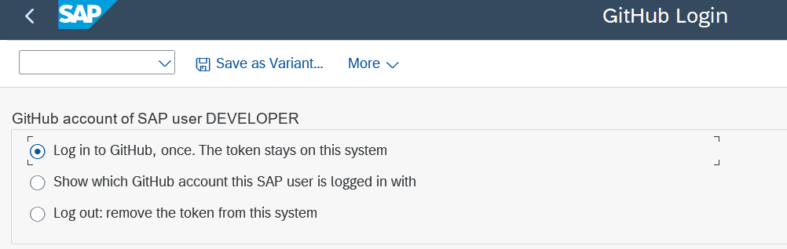
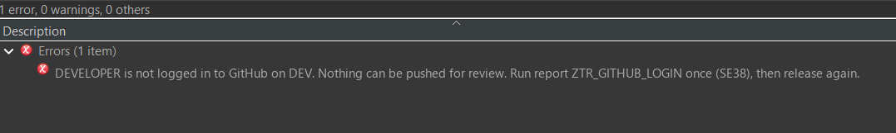

# Every developer acts on GitHub with their own account

No shared account, no token in SM59. Each developer logs in to GitHub once on the SAP system. From then on every push, every pull request and every merge that this person triggers runs under their own GitHub account, also in background jobs. A person who is not logged in cannot release a task or a request with objects under Git.

## How it works

| Piece | Object on the SAP system | Job |
|---|---|---|
| GitHub App | on GitHub, owned by your user or organization | the door on the GitHub side: what the tokens may do, and on which repositories |
| Login report | `ZTR_GITHUB_LOGIN` | GitHub's device flow: shows a code, waits until the developer entered it on GitHub and allowed the app, stores the token. Also shows the status and logs out |
| Token class | `ZCL_TR_AUTH` | keeps one token per SAP user in the cluster table `INDX`, area `ZT`, encrypted with AES-256, and hands out the authorization headers |
| abapGit user exit | `ZCL_ABAPGIT_USER_EXIT`, method `CREATE_HTTP_CLIENT` | Git traffic to `github.com` with the token of the current user |
| Push report | `ZTR_PUSH_TRANSPORT` | pull requests and merges on `api.github.com` with the token of the current user |
| Release check | BAdI implementation `ZTR_RELEASE_CHECK` | refuses the release of anybody who is not logged in |

The device flow needs only the public client ID of the GitHub App. No client secret is stored anywhere in SAP.

**Expiring tokens.** With "Expire user authorization tokens" on (step 1 below), GitHub gives an access token that lives 8 hours and a refresh token that lives 6 months. `ZCL_TR_AUTH` keeps both, encrypted, and renews the access token by itself when less than 5 minutes are left, before a push or an API call, also in background jobs. Nobody has to log in again, unless SAP was not used for 6 months or the token was revoked. Tokens from the device flow are renewed without the client secret. A refresh token works once only, so the renewal runs under a lock per user (`ENQUEUE_E_TABLE` on `INDX`): two jobs of the same user that renew at the same moment do not reject each other.

Why: the AES key lies next to the tokens in `INDX` (see below), so everybody who can run own ABAP on the system can decrypt a token. With expiry a copied access token dies within 8 hours, and when somebody uses a copied refresh token, the owner's next renewal fails and asks for a new login, which shows the misuse. It does not stop somebody who reads `INDX` again and again: treat whatever is stored in SAP as readable by developers, and keep the real gate on GitHub (branch rules, reviews).

Should the program that triggered the renewal roll back its LUW afterwards, GitHub has already replaced the refresh token while SAP keeps the old one: the next use asks for a new login.

**Why our own class and not SAP's OAuth 2.0 client (`OA2C_CONFIG`):** the Git endpoint of GitHub takes a token as Basic authentication with the user name `x-access-token`. SAP's OAuth client sends `Authorization: Bearer`, and its token is not visible to ABAP, so it cannot be turned into the form Git needs.

**Where the token is kept:** SAP's secure storage cannot be used by customer programs. The token is therefore encrypted with AES-256 and kept in the cluster table `INDX`, area `ZT`: one record per user (the encrypted token and the GitHub login name) plus one record with the key. No table has to be created. The console login keeps the pending device code of a login in the same table, as a second row of the user (id `PEND:<user>`, the token is `TOK:<user>`, the key `KEY:SYSTEM`); that row is not encrypted and is removed when the login ends or the code expires.

## Setup

### 1. The GitHub App, by the owner of the user or organization

GitHub, Settings (of the user or organization), Developer settings, GitHub Apps, New GitHub App.

| Field | Value |
|---|---|
| Name | for example `SAP Transport Review` |
| Homepage URL | any URL, for example the one of your repository |
| Callback URL | leave empty |
| Expire user authorization tokens | **on**. Tokens live 8 hours; `ZCL_TR_AUTH` renews them with the refresh token, so nobody logs in daily. Tokens stored before the switch keep working until they are revoked; log in again to get an expiring one |
| Request user authorization during installation | off |
| Enable Device Flow | **on** |
| Webhook, Active | off |
| Repository permissions | Contents: Read and write. Pull requests: Read and write. Metadata: Read-only |
| Where can this app be installed | only on this account |

Then install the App on every repository that holds packages under Git. Note the **Client ID** on the page of the App. No client secret is needed.

Every developer must have write access to those repositories. The App cannot give anybody more than they have.

The rules for the repositories themselves: [GITHUB-REPOSITORY-SETUP.md](GITHUB-REPOSITORY-SETUP.md).

### 2. The SAP system, once

Pulling the repository with abapGit creates all objects ([INSTALL.md](INSTALL.md)). Then report `ZTR_SETUP` writes the client ID of the App to STVARV parameter `ZTR_CLIENT_ID`, and the package pattern to `ZTR_PACKAGES`. The login uses SSL client `ANONYM`, which must trust GitHub's certificate chain (STRUST). Authorizations: nothing special. The class reads and writes `INDX` with EXPORT and IMPORT, which needs no authorization object.

If the system has an old BAdI implementation of `CTS_EXPORT_FEEDBACK` for a similar purpose, deactivate it: its job runs as `DDIC`, who has no GitHub account.

### 3. Every developer, once

1. SA38, `ZTR_GITHUB_LOGIN`, "Log in", execute.
2. A popup shows the code and the address. Select the text, Ctrl+C copies it. Choose Continue. The code stays in the status bar while SAP waits, until the code expires (GitHub sets the time).
3. In the browser, open the address (`https://github.com/login/device`), enter the code, log on to GitHub if asked, and allow the app.
4. The report ends with "Logged in to GitHub as `<login>`".

*What to look at: the three actions, "Log in" is the default.*

*What to look at: the code and the address.*

The report does not open the browser and does not touch the clipboard on purpose: SAP GUI treats both as security-relevant frontend calls, and on some PCs they freeze the session instead of asking Allow or Deny.

In SAP GUI, release in the dialog, a developer who is not logged in gets the same popup when releasing, and the release goes on after the login. In Eclipse (ADT) and in a background release there is no popup: the release is refused with the name of the login report. From ADT the login is done with the class `ZCL_TR_CONSOLE_LOGIN` (optional sub-package `$ZTR_REVIEW_CONSOLE`): run it with F9, it prints the address and the code; enter the code on GitHub and run it again to finish. The console shows output only when a run has ended, which is why it takes two runs.

*What to look at: the Problems view of Eclipse names the user and the report to run.*

The same report shows the status and logs out. Logging out removes the token from SAP. To revoke it on GitHub as well: GitHub, Settings, Applications, Authorized GitHub Apps.

## What the developer sees when something is missing

| Situation | Message |
|---|---|
| Release of a task or request without a login | popup and error: "`<user>` is not logged in to GitHub on `<system>`. Nothing can be pushed for review. Run report ZTR_GITHUB_LOGIN once (SE38), or in ADT class ZCL_TR_CONSOLE_LOGIN, then release again." (in the SAP GUI dialog the text is different, because the login popup comes up first) |
| The same with release in the background | the job `RELEASE OF <request>` is cancelled, the reason is in its log (SM37) |
| Login, but the account cannot reach a linked repository | "GitHub account `<login>` of `<user>` has no access to: `<repositories>`. Ask the admin ..., then release again." |
| Client ID missing in STVARV | login report: "STVARV parameter ZTR_CLIENT_ID is missing: the client ID of the GitHub App" |
| Token revoked or expired on GitHub | the release check refuses with "GitHub does not accept the token of <user> any more (revoked or expired)"; log in again |
| Refresh token refused (revoked, unused for 6 months, or already used elsewhere) | the stored token is removed; the next release or push says the user is not logged in; log in again |
| Code not entered in time | "The code expired before it was entered on GitHub. Try again" |
| App not allowed on GitHub | "You did not allow the app on GitHub. Nothing stored" |

## Order of the test

1. Release a task while not logged in. Expected: refused with the message above.
2. Log in. Expected: "Logged in to GitHub as `<login>`". SE16, table `INDX`, `RELID = ZT` shows one record for the key and one per logged-in user.
3. `ZTR_PUSH_TRANSPORT` with `P_TEST` for a released request. Expected: the log starts with `GitHub account: <login> (<user>)` and the comparison runs. This proves the Git logon with the token.
4. Release a task. Expected: branch and pull request on GitHub, both by `<login>`.
5. A colleague logs in the same way, approves, and the developer releases the request. Expected: merge by `<login>`.
6. Log out and release a task. Expected: refused.
