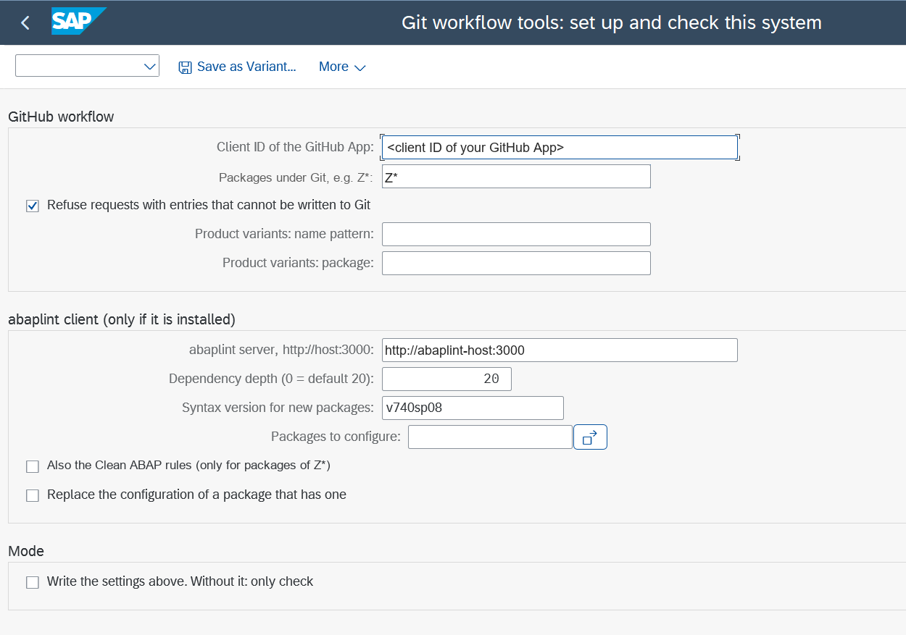
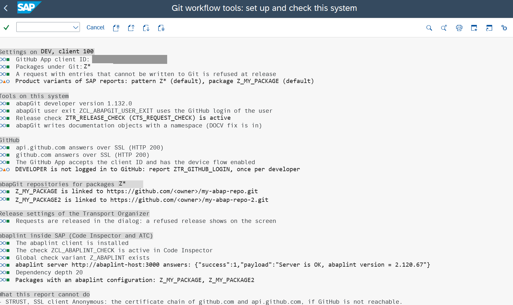
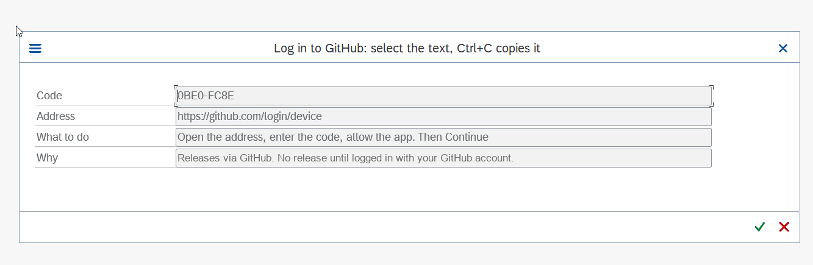

# Installing the tools on an SAP system

A numbered checklist. Every step says what to do, where, what you should see, and what to do if you do not. Report `ZTR_SETUP` can be run as often as you want: without "Write the settings" it only checks. After step 5 it is the quickest way to find out what is still missing.

The tools are local objects of the development system. They are never transported.

## What is automatic and what is not

| Step | How |
|---|---|
| Classes, reports, the release check (BAdI implementation) | abapGit pull of this repository |
| STVARV parameters: client ID of the GitHub App, package pattern, completeness gate, report variants | `ZTR_SETUP` |
| abaplint client: server, dependency depth, configuration per package (optional) | `ZTR_SETUP` |
| Check of everything: SSL to GitHub, device flow, login, linked repositories and access, release settings, abaplint | `ZTR_SETUP` |
| abapGit itself, the abaplint client | abapGit, from their own public repositories |
| Certificates in STRUST | by hand, needs the Basis authorization |
| The GitHub App on GitHub and its installation on the repositories | by hand on GitHub, owner of the user or organization |
| GitHub login of each developer | by hand, each developer once |
| The product repositories linked in abapGit | by hand, one per package |
| abaplint check in Code Inspector, check variants, ATC settings | by hand, SCI and ATC (optional) |

## Before you start

| Needed | Why |
|---|---|
| SAP_BASIS 7.40 SP08 or newer | the sources are ABAP 7.40 syntax |
| Outbound HTTPS from the system to `github.com` and `api.github.com`, port 443 | every call to GitHub |
| A GitHub user or organization that owns the repositories, and its owner at hand | to create and install the App |
| Write access of every developer to those repositories | the App cannot give anybody more than they have |

No SM59 destination is needed: the tools call GitHub through SSL client `ANONYM` directly.

## 1. abapGit developer version

- **Action:** install the abapGit developer version (program `ZABAPGIT`, package `$ABAPGIT`). The standalone report is not enough, because the tools call abapGit classes.
- **Where:** SE38 / `ZABAPGIT`, from the abapGit project.
- **Expected:** `ZABAPGIT` starts and lets you create an online repository.
- **If not:** install it from <https://github.com/abapGit/abapGit> (developer version, see its documentation).

## 2. Certificates for GitHub

- **Action:** in SSL client `ANONYM`, import the root certificates of GitHub's certificate chain. Import the roots, not the certificate of `github.com` itself: that one changes every few months and does not cover `api.github.com`.
- **Where:** STRUST, SSL client `ANONYM` (SSL client Anonymous).
- **Expected:** `ZTR_SETUP` (step 6) shows green lines "api.github.com responds over SSL" and "github.com responds over SSL".
- **If not:** the line shows the error. Check the roots, the outbound proxy, and that port 443 is open.

## 3. GitHub App

- **Action:** create the GitHub App and install it on every repository of your packages. Write down its **Client ID**. Details and the exact settings: [GITHUB-LOGIN.md](GITHUB-LOGIN.md). The repositories and their rules: [GITHUB-REPOSITORY-SETUP.md](GITHUB-REPOSITORY-SETUP.md).
- **Where:** GitHub, Settings (of the user or organization), Developer settings, GitHub Apps.
- **Expected:** the App page shows a Client ID, "Enable Device Flow" is ticked and "Expire user authorization tokens" is off.
- **If not:** change the App settings. With expiring tokens each developer would have to log in again every eight hours.

## 4. Pull the tools

- **Action:** create an online repository for this repository and pull it.
- **Where:** `ZABAPGIT`, New Online.

| Field | Value |
|---|---|
| Git repository URL | the URL of this repository |
| Package | `$ZTR_REVIEW` (Create Package, local, no transport) |
| Branch | `master` |
| Folder logic | Prefix (it comes from `.abapgit.xml`) |

  Then Pull, select everything, activate.
- **Optional sub-package:** the folder `src/console/` becomes the sub-package `$ZTR_REVIEW_CONSOLE` with two ADT console classes. They need the interface `IF_OO_ADT_CLASSRUN` (check in SE24). If it does not exist on your system, deselect the sub-package in the pull; activation of those two classes would fail, nothing else.
- **Expected:** the objects of the table below exist and are active. The BAdI implementation `ZTR_RELEASE_CHECK` is active at once (SE19), but it **does nothing until step 6 has written the client ID** (`ZTR_CLIENT_ID`), so nobody's release is affected before then. From step 6 on, every release of a task or request that holds objects of the packages under Git needs a GitHub login (step 7). To switch the check off for everybody, set the STVARV parameter `ZTR_DISABLED` to `X` (SM30 or STVARV); to remove it completely, deactivate the implementation in SE19.
- **If not:** if the repository is private, abapGit asks for a GitHub user and password at this first pull: enter your user and, as the password, a personal access token; nothing is stored in SAP, abapGit keeps it for the session only. Without any token: download the repository as ZIP and use New Offline, Import ZIP.
- **Warnings:** the user exit `ZCL_ABAPGIT_USER_EXIT` was written against one abapGit version. Methods that a newer abapGit added to the exit interface are not implemented; abapGit handles that. The activation then shows warnings, not errors. If the system already has its own `ZCL_ABAPGIT_USER_EXIT`, the pull replaces it: merge by hand.
- **From now on** all Git traffic to github.com on this system runs with the developer's own GitHub login (step 7); the abapGit popup for user and password is gone.

## 5. Check what the pull created

| Object | Kind | Check |
|---|---|---|
| `ZTR_SETUP`, `ZTR_GITHUB_LOGIN`, `ZTR_PUSH_TRANSPORT`, `ZTR_APPLY_CONTENT`, `ZTR_TRANSL_REPORT` | reports | SA38 finds them |
| `ZCL_TR_AUTH`, `ZCL_TR_CONTENT`, `ZCL_TR_CONTENT_APPLY`, `ZCL_ABAPGIT_USER_EXIT`, `ZCL_IM_TR_RELEASE_CHECK`, `ZCL_TR_TRANSL_CHECK`, `ZCL_TR_TRANSL_FILE`, `ZCL_TR_TRANSL_HARDCODED`, `ZCL_TR_TRANSL_TABLE_TEXTS`, `ZCL_IM_TR_TRANSL_CHECK` | classes | SE24 finds them, active |
| `ZTR_RELEASE_CHECK`, `ZTR_TRANSL_CHECK` | BAdI implementations of `CTS_REQUEST_CHECK` | SE19 shows them active. `ZTR_TRANSL_CHECK` does nothing until step 6 sets required languages and a mode other than `OFF` |

- **If the BAdI implementation is not active:** SE19, open `ZTR_RELEASE_CHECK`, activate. From this moment every release of a task or request with objects under Git goes through the check.

## 6. Run ZTR_SETUP

- **Action:** run it, fill the fields, tick "Write the settings", execute.
- **Where:** SA38, `ZTR_SETUP`.

Block "GitHub workflow":

| Field on the screen | What to enter |
|---|---|
| Client ID of the GitHub App | the Client ID of step 3 (it is not a secret). STVARV `ZTR_CLIENT_ID` |
| Packages under Git, e.g. Z* | the pattern of the packages under Git on this system, for example `Z*`. STVARV `ZTR_PACKAGES`. The release check looks at the names of the objects of the task or request, the push at the packages of the repositories linked in abapGit. Choose a pattern that fits both, for example your namespace |
| Refuse requests with entries that cannot be written to Git | tick it only when `ZTR_PUSH_TRANSPORT` with the baseline option shows no gaps. STVARV `ZTR_REQUIRE_COMPLETE` |
| Report variants: name pattern | optional. Report variants with such a name are written to `content/variants`. STVARV `ZTR_VARIANT_PATTERN` |
| Report variants: package | optional. The package that owns those variants; it decides the repository they go to. STVARV `ZTR_VARIANT_PACKAGE` |

Block "Translation check at release" (optional, see [TRANSLATION-CHECK.md](TRANSLATION-CHECK.md)):

| Field on the screen | What to enter |
|---|---|
| Required languages | the languages every user-visible text must have, for example `D` and `E`. STVARV `ZTR_TRANSL_LANGUAGES`. Empty: the check does nothing |
| Mode | `OFF` (default: no check at release, the report still works), `INFORM` (show, the release goes on) or `BLOCK` (refuse the release). STVARV `ZTR_TRANSL_MODE`. Start with `OFF`, run `ZTR_TRANSL_REPORT`, then `INFORM` |
| At release: record the existing translations in the task | off by default; test it before you switch it on. STVARV `ZTR_TRANSL_RECORD` |
| Object names never checked | optional, for example internal tools. STVARV `ZTR_TRANSL_EXCLUDE` |

Block "abaplint client (only if it is installed)": see [ABAPLINT-IN-SAP.md](ABAPLINT-IN-SAP.md). Leave it empty if you do not use abaplint.

Block "Mode":

| Field | Meaning |
|---|---|
| Write the settings above. Without it: only check | tick to save; without it the report only checks and changes nothing |

An empty field removes the parameter, so the default applies again.

*What to look at: the blocks "GitHub workflow" and "abaplint client", and the box "Write the settings above".*

- **Expected:** read the output from top to bottom. Green is done, yellow is information, red is something to do. The last line is "Nothing left to do on `<system>`, apart from the manual steps above".

*What to look at: no red line.*

- **If not:** each red line names what is missing and what to do. The lines are, in order: abapGit version, the user exit, the release check and whether it is active, whether an old BAdI implementation of `CTS_EXPORT_FEEDBACK` (`ZTR_EXPORT`) is active (deactivate it: its job runs as `DDIC`, who has no GitHub account), documentation objects with a namespace, GitHub over SSL, the device flow of the App, the login of your user, the linked repositories and the access to them, release settings, abaplint, the translation check. The list of what the report cannot do is at the end.

## 7. GitHub login, every developer once

- **Action:** log in.
- **Where:** SA38, `ZTR_GITHUB_LOGIN`, "Log in", execute. In Eclipse ADT without SAP GUI: the class `ZCL_TR_CONSOLE_LOGIN` (optional sub-package, step 4), run twice with F9: the first run prints the address and the code, enter it on GitHub, the second run finishes the login.
- **Expected:** a popup shows a code and an address. Open the address in a browser (the report does not open it for you), enter the code, allow the app. The report waits and then ends with "Logged in to GitHub as `<login>`".

*What to look at: the code and the address in the popup.*

- **If not:** "STVARV parameter ZTR_CLIENT_ID is missing" means step 6 was not run with "Write the settings". "The code expired before it was entered on GitHub" means run it again. "You did not allow the app on GitHub" means you chose Cancel on GitHub: run it again. More in [GITHUB-LOGIN.md](GITHUB-LOGIN.md).
- Without this step a developer cannot release a task or request with objects under Git, and cannot use abapGit against github.com.

## 8. Link the repositories

- **Action:** one online repository per package under Git, branch `master`.
- **Where:** `ZABAPGIT`, New Online. Then run `ZTR_SETUP` again.
- **Expected:** "`<login>` has access to every linked repository".
- **If not:** the line names the repositories the logged-in developer cannot reach: "install the GitHub App on it, give the user write access".
- A system that already has released and open transports: read [EXISTING-SYSTEM.md](EXISTING-SYSTEM.md) first. It gives the order (initial content on GitHub, then the review rule) and says what happens to open requests.

## 9. GitHub side

- **Action:** protect the default branch, set the merge options, add CODEOWNERS.
- **Where:** [GITHUB-REPOSITORY-SETUP.md](GITHUB-REPOSITORY-SETUP.md).
- **Expected:** a pull request into the default branch needs one approval and can only be squash merged.

## 10. Release settings

- **Action:** release in the dialog, not in the background, so that a refused release shows on the screen.
- **Where:** SE03, Administration, Global Customizing (Transport Organizer).
- **Expected:** `ZTR_SETUP` shows "Requests are released in the dialog".
- **If not:** with background release, a refused release only shows in the log of the job `RELEASE OF <request>` in SM37.
- Optional checks at release (ATC, abaplint): [ATC-AT-RELEASE.md](ATC-AT-RELEASE.md), [ABAPLINT-IN-SAP.md](ABAPLINT-IN-SAP.md).

## 11. End-to-end test

Use a test package under Git and a test request.

1. **Not logged in:** with a user who has not run `ZTR_GITHUB_LOGIN`, release a task. Expected: refused, "`<user>` is not logged in to GitHub on `<system>`" with the name of the login report.
2. **Log in:** run `ZTR_GITHUB_LOGIN`. Expected: "Logged in to GitHub as `<login>`".
3. **Release a task:** change one object in a new request (start the request text with an issue key, for example `ABC-123 test`, see [JIRA.md](JIRA.md)). Release **only the task**.
4. **Job:** SM37, your user, job `GIT_REVIEW_<request>`. Expected: finished; the log starts with `GitHub account: <login> (<user>)` and contains the line "pull request opened" with its link.

<!-- screenshot, see docs/images/README.md

*What to look at: the log lines with the files pushed and the pull request link.*
-->

5. **Notice:** an express document with the link arrives in your SAP inbox (SBWP).
6. **GitHub:** branch `review/<request>` with one commit and a pull request opened by your GitHub login.
7. **Second task:** change the object again; SAP creates a new task in the same request. Release it. Expected: a second commit on the same pull request.
8. **Request too early:** release the request before the approval. Expected: refused, "pull request `<n>` is not approved yet".
9. **Approve:** a colleague approves the pull request on GitHub. Do not merge it.
10. **Release the request.** Expected: released; SM37 shows job `GIT_MERGE_<request>` with "pull request `<n>` squashed and merged"; on GitHub the pull request is merged and the review branch is gone.
11. **Translation check** (only if set up): change a text of a test object in one required language only, release the task. Expected in mode `INFORM`: a popup in SAP GUI that names the text, "Translate" opens `ZTR_TRANSL_REPORT`; the pull request description has a section "Missing translations". In mode `BLOCK` the release is refused until the text is translated.

If something fails, [WORKFLOW.md](WORKFLOW.md) lists the results of the release check and README has a troubleshooting table.

## Updating the tools

On the system where a tool was changed: `ZABAPGIT`, this repository, Stage, Commit. On every other system: `ZABAPGIT`, this repository, Pull. Settings are not touched by a pull.

## Limits that travel with the tools

Read "Limits" in [WORKFLOW.md](WORKFLOW.md): one working copy per system, one selected branch per repository in abapGit, and the token of a developer being readable by anybody who can run ABAP on that system.
