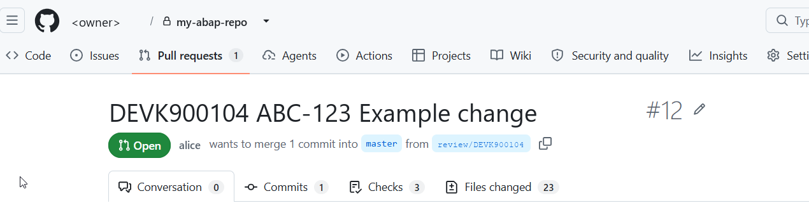
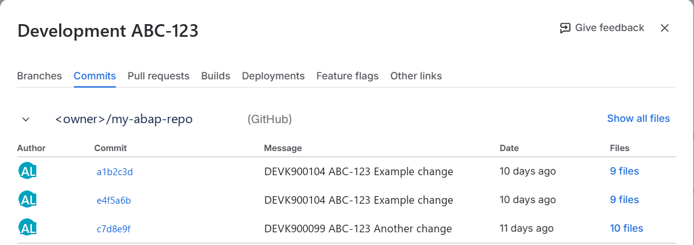

# Jira (or another ticket system): how the issue key reaches GitHub

The tools do not talk to Jira. They put the **text of the transport request** into the commit message, the pull request title and the pull request description. If the request text starts with the issue key, the key is in all of them, and the integration between GitHub and Jira can do the rest.

## The convention

Start the short text of every request with the issue key, then a short description:

```
ABC-123 Fix posting date check
```

The same for the text of a request created by report `ZTR_APPLY_CONTENT` (its field says "Jira key first"). The key is only a convention of the team: nothing in the tools checks it.

## What the tools write, from the source

| Where | Text | Where it comes from |
|---|---|---|
| Branch name | `review/<request>`, for example `review/ABCK900123` | the request number. The issue key is **not** in the branch name |
| Commit message on the review branch, first line | `<request> <request text>`, for example `ABCK900123 ABC-123 Fix posting date check` | the description of the request (SE09), English first, then any other language |
| Commit message, body | `Task <task>` for a task push | the task number |
| Pull request title | the first line of the commit message: `ABCK900123 ABC-123 Fix posting date check` | same |
| Pull request description | `Request <request>: <request text>`, then `Tasks pushed from <system>:` with one line per push, then `## Documentation from SAP` | request text, the tasks, and the documentation of the request and its tasks from SE09/SE10 |
| Squash commit on the base branch | title: the pull request title followed by `(#<number>)`; message: the pull request description | at the merge |

So the key appears in the commit messages, in the pull request title, in the pull request description and in the squash commit. If you also write the key into the documentation of the request (SE09), it is in the description as well.

<!-- screenshot, see docs/images/README.md

*What to look at: the title starts with the request number and then the issue key.*
-->

## What Jira and GitHub do, not these tools

The Development panel of a Jira issue (branches, pull requests, commits) comes from the integration between GitHub and Jira, for example the **GitHub for Jira** app. It has to be installed and connected to your GitHub user or organization, and it must be allowed to see the repositories. Atlassian documents that such an integration links a branch, a commit or a pull request to an issue when the issue key is in the branch name, the commit message or the pull request title; see the documentation of the app for the exact rules of your version. With the convention above the commit messages and the pull request title carry the key, so the link is made from them.

This is configuration on the Jira and GitHub side. The tools do not install, call or check it.

<!-- screenshot, see docs/images/README.md

*What to look at: the pull request and the commits listed in the Development panel of the issue.*
-->

## What is not there

- **No rule that refuses a release without an issue key.** The sources have no such check. It is a possible extension: the release check (`ZCL_IM_TR_RELEASE_CHECK`) already reads the request text for `#NOREVIEW`, so a test of the text against a pattern such as `^[A-Z][A-Z0-9]+-[0-9]+` could be added there. It is not part of the tools today.
- **No call to Jira.** Nothing is written to the issue by the tools: no comment, no transition.
- **The key is not in the branch name.** If your Jira setup links only by branch name, the title and commit messages still carry the key; whether your integration accepts that depends on its rules.
