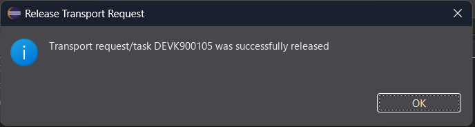
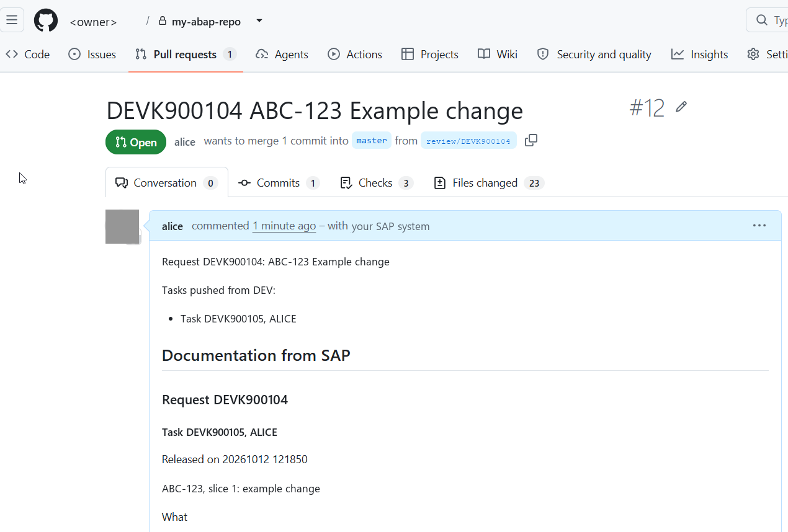
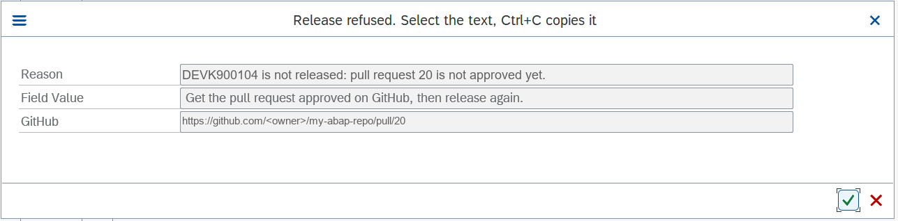

# The workflow: review per task, one commit per request

Goal:

- A released **task** goes to GitHub as a commit on a review branch. A pull request from that branch is the code review.
- The developer fixes findings in a new task of the same request. Each released task adds a commit to the same pull request.
- After approval the developer releases the **request**. The release squashes and merges the pull request as one commit.
- The Git log of the base branch is then the list of requests.

Nothing is transported for this. abapGit reads the objects from the SAP system and writes files to GitHub. The SAP system stays the source, Git is the mirror.

Everything on GitHub happens under the developer's own account. Each developer logs in once with report `ZTR_GITHUB_LOGIN`; the token is kept per user, encrypted. There is no shared account and no token in SM59. See [GITHUB-LOGIN.md](GITHUB-LOGIN.md).

## How it works

| Event on the SAP system | What happens |
|---|---|
| Anybody releases a task or request with objects under Git | BAdI `CTS_REQUEST_CHECK` (implementation `ZTR_RELEASE_CHECK`) checks that this person is logged in to GitHub, and that the GitHub account can reach the linked repositories. If not, the release is refused with the reason. In SAP GUI, release in the dialog, a login popup comes up first and the release goes on after the login. |
| Task released | The BAdI starts the job `GIT_REVIEW_<request>` as the developer. The job waits until the task is really released, commits the objects of the task to the branch `review/<request>` (created from the base branch if it does not exist) and opens the pull request as the developer. |
| Another task of the same request released | Same job. A further commit on the same branch, so the open pull request is updated and an approval given before is cancelled. The reviewers are asked again. |
| Request about to be released | The BAdI asks `ZTR_PUSH_TRANSPORT` in check mode whether the current state of the objects of the request is reviewed. If not, the release is refused. Objects that are on no branch are pushed to `review/<request>` so that they get reviewed. |
| Request released | The BAdI starts the job `GIT_MERGE_<request>` as the developer. It waits until the request really is released and then squashes and merges the approved pull request into the base branch. GitHub deletes the review branch if the repository is set up for it. |

<!-- screenshot, see docs/images/README.md

*What to look at: the release of a task finishes at once; the work runs in the job.*
-->

The base branch is parameter `P_BASE` of the report, default `master`. With `P_BASE` empty, the default branch of the GitHub repository is used.

Only tasks and requests with at least one object whose name matches the pattern in STVARV `ZTR_PACKAGES` go through this (the check looks at object names). Only repositories linked in abapGit to a package that matches the pattern are touched (the push looks at the package of the repository). Transports of copies are never pushed. Customizing requests and tasks (types W and Q) go through the same review as workbench requests.

## What is written

- **Commit on the review branch:** the first line is `<request> <request text>`. The request text is the description of the request, English first, then any other language. For a task the body adds `Task <task>`. The committer is the name and e-mail of the task or request owner from the user master data (SU01). The same first line is used for every commit and for the pull request title.
- **Pull request:** the title is the first line above. The description starts with `Request <request>: <request text>`, then `Tasks pushed from <system>:` with one line per push (`- Task <task>, <owner>`), then the section `## Documentation from SAP`. A section about entries that could not be written to Git is added when there are any.
- **Documentation:** the text written in SE09/SE10 for the request and for each of its tasks goes into `## Documentation from SAP`, one sub-heading per request and task. English is taken first, then the logon language, then any language. The section is rebuilt at every push, and once more at the merge, so the squash commit holds the documentation as it was when the request was released.
- **Squash commit on the base branch:** title is the pull request title followed by `(#<number>)`, message is the pull request description.

How the issue key of a ticket system reaches these texts: [JIRA.md](JIRA.md).

<!-- screenshot, see docs/images/README.md

*What to look at: title, the task list and the documentation section in the description.*
-->

## What stops a release without review

When a request with objects under Git is released, the BAdI asks one question: is the current state of every object of this request reviewed? "Current state" is exact: each file is compared with the branch. A file that differs in content, a file that is missing on the branch, and a file on the branch that no longer exists on the system all count as a difference. Other objects are not looked at, so open work of other requests does not matter.

Reviewed means one of two things:

- The state is on `review/<request>` and the pull request of that branch can be merged: GitHub reports it as mergeable, which means the rules of the base branch are met (the approval, resolved conversations, checks). If a ruleset restricts who may merge, GitHub reports every pull request as blocked; then the tool asks GitHub directly and counts the pull request as approved only when it is approved, mergeable, on the commit that was judged, all review conversations are resolved and the checks of that commit did not fail.
- There is no review branch, and the state is on the base branch. That is the case after somebody merged the pull request by hand.

| Result of the check | What happens |
|---|---|
| On the review branch, pull request approved (status A) | The release goes on. Job `GIT_MERGE_<request>` squashes and merges the pull request as soon as the request is released. |
| On the base branch already, no review branch (status O) | The release goes on. Nothing to merge. |
| Pull request not opened, not approved, or cannot be merged (status P) | The release is refused. The message names the pull request. |
| Files differ from the review branch, or from the base branch when there is no review branch (status D) | The release is refused. A job pushes the objects of the request to `review/<request>`. A new commit cancels an approval given before, so the change is reviewed again. |
| Another push is running (status B) | The release is refused with the advice to try again in a minute. The check waits up to 60 seconds for the lock first. |
| The request holds entries that nothing can write to Git (status U) | Refused only when STVARV `ZTR_REQUIRE_COMPLETE` is `X`: "not everything can go to Git". Otherwise the entries are listed in the pull request and the job log. |
| The check itself failed, for example GitHub is not reachable (status E) | The release goes on, with an information message in the dialog (nothing in the background). No job is started, so the change is not reviewed and does not reach the base branch on its own; the check fails open. The base branch only takes reviewed pull requests, so the base branch only takes reviewed pull requests. |

The check looks at content, not at jobs. So it also catches what never went through a task: an object put into the request directly, a request that was merged from another one, a task whose push failed, and a change made after somebody merged by hand. If GitHub cannot be asked about the pull request, it does not count as reviewed.

The merge is done by GitHub under its own rules. SAP asks for it with the GitHub account of the person who releases, and names the commit that was approved. GitHub refuses the merge of a pull request that is not approved or that got a new commit in the meantime. If the merge fails after the release, the job `GIT_MERGE_<request>` is cancelled and the pull request stays open: merge it on GitHub by hand.

The merge happens after the release, not before, so that a release that fails in a later check leaves the base branch untouched. If the request is not released within 10 minutes of the start of the job, the job ends without merging.

**One deliberate exit:** a request whose short text contains `#NOREVIEW` is released without the check. Use it for an emergency only; the marker stays visible in the request. It only affects the release of the request: its tasks are still pushed and their pull request is opened as usual. At the release of the request there is no login check, no review check and no merge job, so the pull request stays open and the base branch does not get the change. Afterwards an admin merges it on GitHub, or the next request on the same objects pushes it for review again.

### How a refusal shows

| Where the release runs | What the developer sees |
|---|---|
| SAP GUI, release in the dialog | a popup "Release refused" with the whole reason and the link (the text can be selected and copied), then the error message |
| SAP GUI, release in the background (SE03 setting) | the job `RELEASE OF <request>` is cancelled; the reason is in its log in SM37 |
| Eclipse (ADT) | the error message of the release. There is no popup and no login dialog: a developer who is not logged in is refused with the name of the login report and runs it in SAP GUI, or runs the console class `ZCL_TR_CONSOLE_LOGIN` from ADT (optional sub-package) |

<!-- screenshot, see docs/images/README.md

*What to look at: the reason names the pull request and says what to do next.*
-->

### After the push: the notice

When the job has finished, it sends an **express document** to the SAP inbox of the user who released. It contains the request or task, the branch, the repository and the link of the pull request, or the link that opens one when none is open. SAP GUI announces an express document with a popup. The document stays in the inbox (SBWP) too.

<!-- screenshot, see docs/images/README.md

*What to look at: the link of the pull request in the text of the document.*
-->

A developer who works only in Eclipse (ADT) has no inbox and no popup. The same link is in the log of the job (SM37) and on GitHub. Reviewers get their review request from GitHub.

<!-- screenshot, see docs/images/README.md

*What to look at: the line "pull request opened" with the link.*
-->

### Who opens and who approves the pull request

The pull request is opened by the push job under the GitHub account of the developer who released the task. GitHub therefore knows who wrote the change and does not let that person approve it. Nobody has to click anything.

Who is asked to review comes from `.github/CODEOWNERS` in the repository, see [GITHUB-REPOSITORY-SETUP.md](GITHUB-REPOSITORY-SETUP.md). When a further task is pushed to an open pull request, the job asks GitHub to request the review again from everybody who was asked or has reviewed, so that they are notified.

If opening the pull request fails, the job log says so with the HTTP status, the developer gets the express document with a link that opens the pull request on GitHub, and the release of the request is refused until a pull request exists.

## The rule for the team

1. Log in to GitHub once with `ZTR_GITHUB_LOGIN`. Without it nothing with objects under Git can be released.
2. Release the task when the work is ready for review. Do not release the request yet. The pull request opens automatically, in your name.
3. Reviewers comment on GitHub. Fixes are made on the SAP system, in a **new task of the same request**: release it, and the job adds a new commit to the same branch, so the same pull request shows the change. The approvals given before are dismissed, so the reviewer approves again. Never commit suggestions or edit on GitHub: the next push from the system overwrites it.
4. After approval: release the request. The merge happens automatically, from SAP. Do not merge the pull request on GitHub: the base branch must contain only released work. The repository rule of [GITHUB-REPOSITORY-SETUP.md](GITHUB-REPOSITORY-SETUP.md) stops it.

## The report by hand

`ZTR_PUSH_TRANSPORT` (SA38). Everything it does runs with your GitHub account.

| Parameter (text on the screen) | Use |
|---|---|
| `P_TRKORR` (Task or request) alone | repeat the push of a released task, or the merge and the final push of a released request |
| `P_TEST` (Test run) | show what would be pushed, push nothing |
| `P_REVIEW` (Push the objects of an unreleased request to its review branch) | for objects that were put into the request without a task |
| `P_CHECK` (Only check whether the request is reviewed) | gives the result of the check to the BAdI; nothing is pushed |
| `P_BASELN` (Baseline) | no transport: compares every object of the packages with GitHub and writes whatever is missing there, including the content of [NOT-IN-GIT.md](NOT-IN-GIT.md), to `review/CONTENT-BASELINE`, and lists what nothing can write |
| `P_AUTOPR` (Open the pull request of the review branch) | on by default |
| `P_BASE` (Base branch) | another base branch than `master`, for example a hotfix branch |
| `P_PACK` (Packages of the repositories) | only repositories of these packages; default from STVARV `ZTR_PACKAGES` |

## Daily use

| Task | How |
|---|---|
| Log in to GitHub, see who I am, log out | SA38, `ZTR_GITHUB_LOGIN` |
| Repeat a failed push or merge | SA38, `ZTR_PUSH_TRANSPORT`, enter the task or request |
| See what is released but not reviewed | the open pull requests on GitHub |
| Push to another branch once, for example a hotfix branch | run the report by hand with that branch in `P_BASE` |
| Switch the automation off | SE19, deactivate `ZTR_RELEASE_CHECK` |
| Check a changed source before pasting it | `python scripts/syntax-check.py <file>` compiles the file on a system without creating anything |

## Limits

- The commit holds the state of the objects at the time of the push, not a frozen state of the task. If an object is changed again within seconds of the release, that change is in the commit too.
- One shared system, one working copy. If two open requests hold different methods of the same class, the review branch of one shows the unreleased change of the other.
- abapGit keeps one selected branch per repository, for all users. While a push job runs, the repository in abapGit shows the review branch. Do not work on this repository in the abapGit screen during a push. The job switches back to the base branch at its end.
- Pushes run one after the other. A push job waits up to 30 minutes for a running push, then it is cancelled and must be repeated by hand. The job of a task waits up to 10 minutes for the release.
- Each push compares the whole repository once.
- Two pull requests that change the same file can conflict on GitHub. Merge the older one first. Then run the report by hand for the last task of the second one, so that its branch gets the current state of the system. If GitHub still reports a conflict, resolve it by keeping the version of the review branch.
- A repository is only compared when the task or request has an object in its package tree, or contains a deleted object. An object that is moved from the package tree of one repository into another is pushed to the new repository, but its old files stay in the old one until they are removed there by hand.
- Git holds repository objects and the content described in [NOT-IN-GIT.md](NOT-IN-GIT.md). Anything else a transport carries is listed in the pull request as not in Git.
- If GitHub is down, a release of a task works and the push job is cancelled. If only the question for the pull request fails while the review branch is readable, the release of the request is refused.
- A developer whose token was revoked on GitHub still has a token on the SAP system. The release check then refuses the release with "GitHub does not accept the token of <user> any more (revoked or expired)" and the developer logs in again.
- The token is encrypted with a key that is kept in the same cluster table. On a development system where developers can run any ABAP, a developer can read another developer's token with their own code, and then act as that developer on GitHub, including approving their pull request. Use the tools on development systems only.
- Settings (STVARV) and logins (cluster table INDX) are per client. Set up and log in in the client in which developers release.
- The release check fails open. If it cannot decide, or fails with an unexpected error, the release goes on. It does nothing before `ZTR_CLIENT_ID` is written and when `ZTR_DISABLED` is `X`. If the class of the check cannot be loaded, every release fails with a short dump until the implementation `ZTR_RELEASE_CHECK` is deactivated in SE19.
- A check inside the release runs a wait and may show a popup; both can end the database unit of work of the release in the dialog. The check also switches the selected branch of the abapGit repository while it runs.
